# Automated 3-Tier Web Application Infrastructure on Kubernetes with Autoscaling and Datadog Monitoring

This repository contains the complete setup for deploying a 3-tier web app on AWS. It provisions EC2 instances using Terraform, configures nodes with Ansible, runs the application on Kubernetes with HPA enabled, and automates builds through Jenkins. Cluster monitoring and metrics are handled via Datadog.

---

## Architecture Overview

The workload runs across three isolated layers inside Kubernetes:

* **Frontend Layer:** NGINX serving static UI assets and routing API requests on standard HTTP port 80 (NodePort 30080).
* **Backend Layer:** Java 21 REST API exposing health endpoints (`/api/health`, `/api/db-status`) and handling business logic.
* **Database Layer:** MySQL 8.0 instance running with persistent volume storage (PVC) and Kubernetes Secrets for credential injection.


```text
                     [ Internet / User ]
                              │
                              ▼ (Port 80 / NodePort 30080)
            [ NGINX Frontend : capstone-frontend ]
            (nginx:alpine | 2 Replicas for High Availability)
                              │
                              ▼ (Internal ClusterIP :8080)
            [ Java Backend API : simple-java-app ]
            (Java 21 / Spring Boot | HPA: 2 to 5 Pods)
                              │
                              ▼ (Internal ClusterIP :3306)
            [ Database Layer : capstone-db ]
            (MySQL 8.0 | Persistent Storage PVC)
```

---

## Tech Stack

* **Stack:** AWS, Terraform, Ansible, Kubernetes, Jenkins, SonarQube, Datadog, Java 21, MySQL

---

## Infrastructure Specifications (Terraform)

Terraform configurations located in `terraform/` provision the base cloud environment on AWS (`ap-south-1`):

* Dedicated VPC (`10.0.0.0/16`) with isolated public and database subnets.
* Security Groups restricting access to required ports (22, 80, 443, 6443, 8080, 9000, 30080).
* Dedicated EC2 instances for Jenkins build server, K8s Control Plane, and K8s Worker.

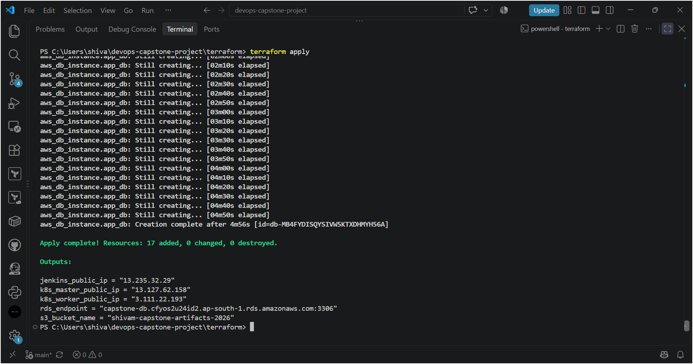
*Terraform state showing 17 managed resources provisioned.*

---


## Node Configuration & Dependencies (Ansible)

Ansible playbooks in `ansible/` handle automated host provisioning:
* System packages, security updates, and required kernel modules.
* Container runtime (`containerd`) and Kubernetes components (`kubeadm`, `kubelet`, `kubectl`).
* Build server dependencies including OpenJDK 21, Jenkins LTS, and SonarQube.

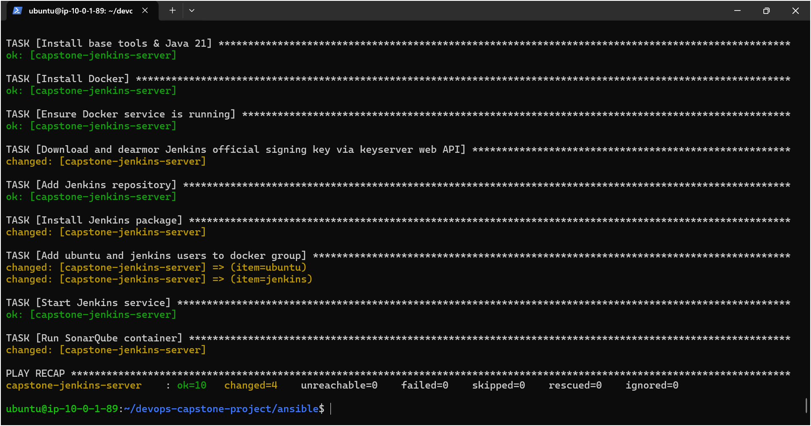
*Ansible execution confirming zero failed tasks across target inventory.*

---


## Kubernetes Cluster Architecture

* **Control Plane:** Ubuntu 24.04 (`c7i-flex.large`), managing cluster state and API server.
* **Worker Node:** Ubuntu 24.04 (`c7i-flex.large`), running application workloads.
* **Network Plugin:** Calico CNI managing internal Pod CIDR routing.

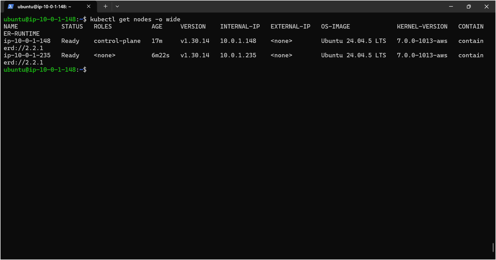
*Cluster node status and container runtime version.*

---


## CI/CD Pipeline & Quality Gate (Jenkins + SonarQube)

Automated build and release workflow triggered by GitHub webhooks:
* **Source Control:**  Webhook trigger on branch push events.
* **Build:**  Maven compilation using OpenJDK 21.
* **Quality Gate:**  SonarQube static code analysis checking security hotspots, code smells, and bugs.
* **Artifact Storage:**  Packaged `.jar` files versioned and archived to AWS S3.
* **Container Registry:**  Image builds tagged and pushed to Docker Hub (`shivamgupta898`).
* **Deployment:**  Rolling update applied to Kubernetes deployment manifests.

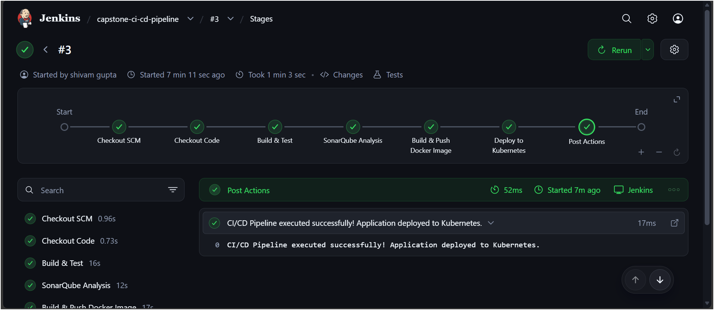
*Jenkins pipeline stages executing build, analysis, and deployment.*

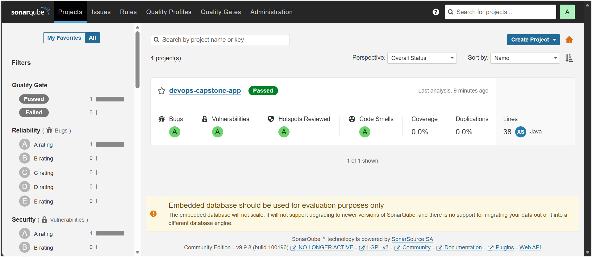
*SonarQube dashboard confirming passing Quality Gate status.*

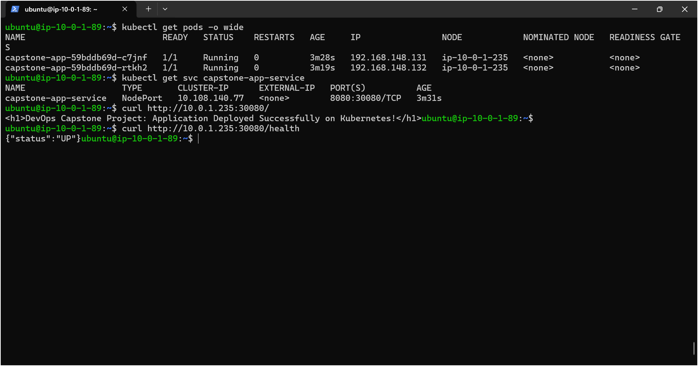
*Application service responsiveness check on target node.*

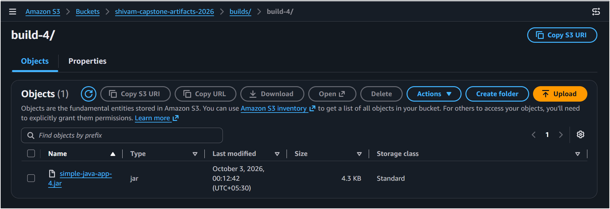
*Versioned build artifacts archived in AWS S3.*

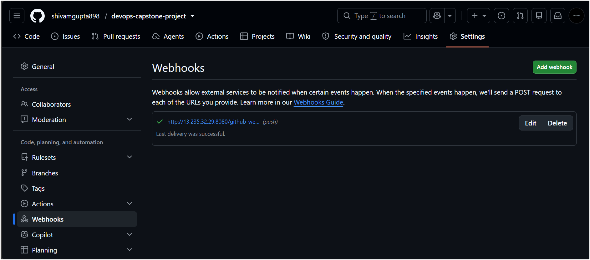
*Repository webhook integration for automated pipeline triggers.*

---


## Application Workloads & Networking

* **Frontend:** Deployed via `capstone-frontend-deploy` with 2 replicas behind `capstone-frontend-service` (NodePort 30080 / Port 80).
* **Backend:** REST API service running on ClusterIP `8080`, exposing `/api/health` and `/api/db-status`.
* **Database:** Dedicated MySQL 8.0 deployment with PersistentVolumeClaim mounted at `/var/lib/mysql`.

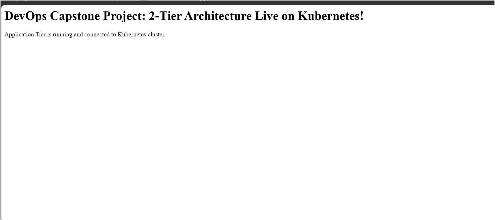
*Web application interface running on the cluster.*

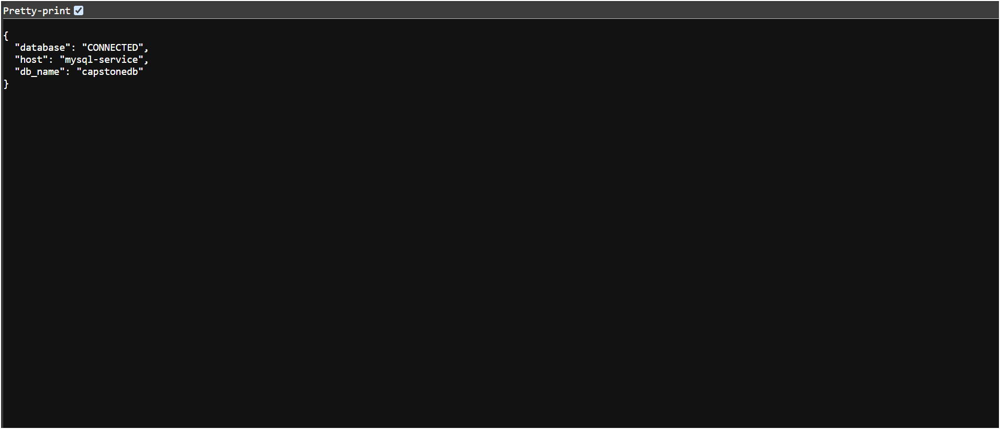
*REST API endpoint returning active database connectivity.*

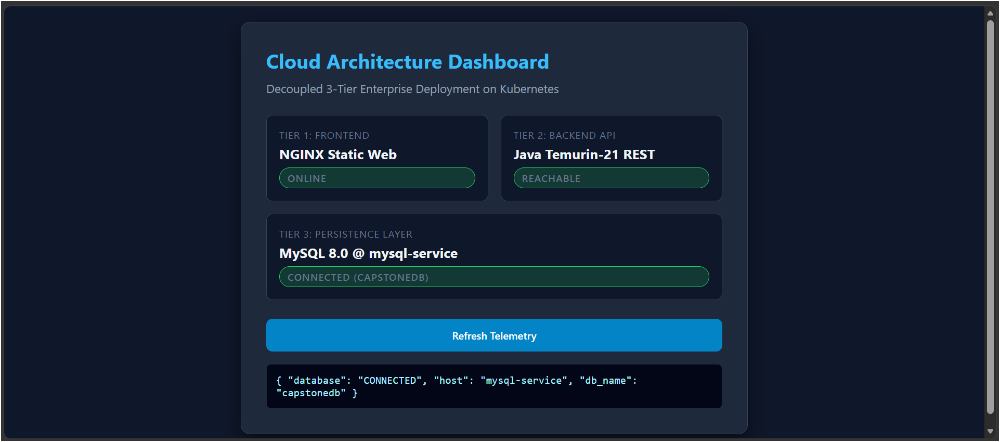
*Full-stack dashboard confirming health across all three tiers.*

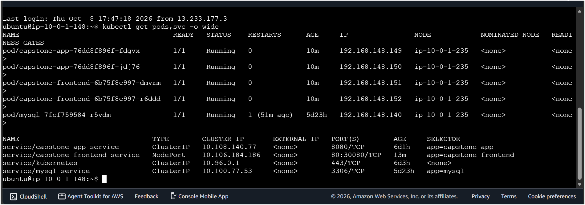
*Active cluster state showing pods, services, and namespace bindings.*

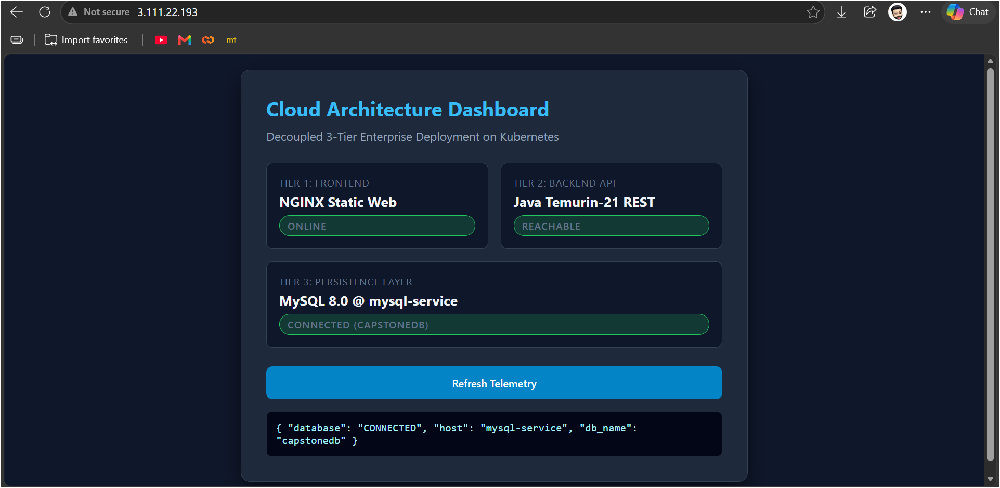
*Direct routing over standard HTTP port 80.*

---


## Autoscaling & Observability

### Horizontal Pod Autoscaler (HPA)
The backend deployment is monitored by the Kubernetes Metrics Server and autoscaled via HPA:
* **Metric Target:** 60% average CPU utilization
* **Min Replicas :** 2 pods
* **Max Replicas :** 5 pods
* **Stabilization:** Downscale stabilization window to prevent rapid scale flapping under bursty loads.

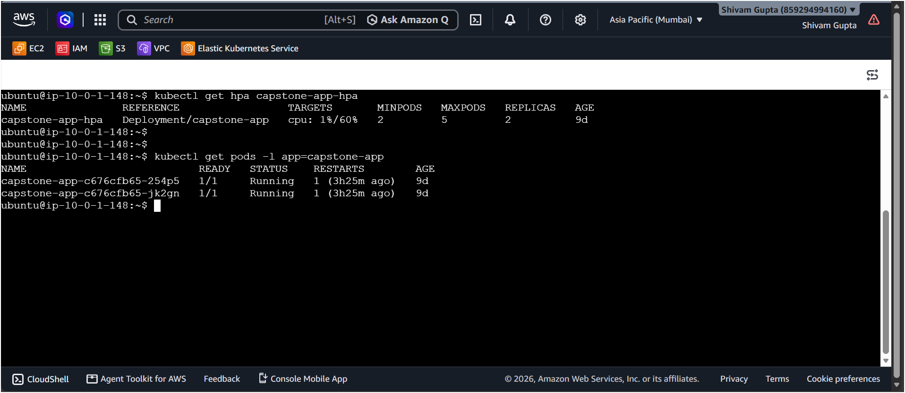
*HPA metrics tracking CPU usage and stabilizing at baseline replicas.*

### Real-Time Monitoring (Datadog)
Cluster-level telemetry collected by the Datadog Agent running on nodes:
* Real-time pod CPU and memory utilization tracking.
* Metric spikes captured during high-concurrency request generation.
* Automated pod lifecycle and restart monitoring.

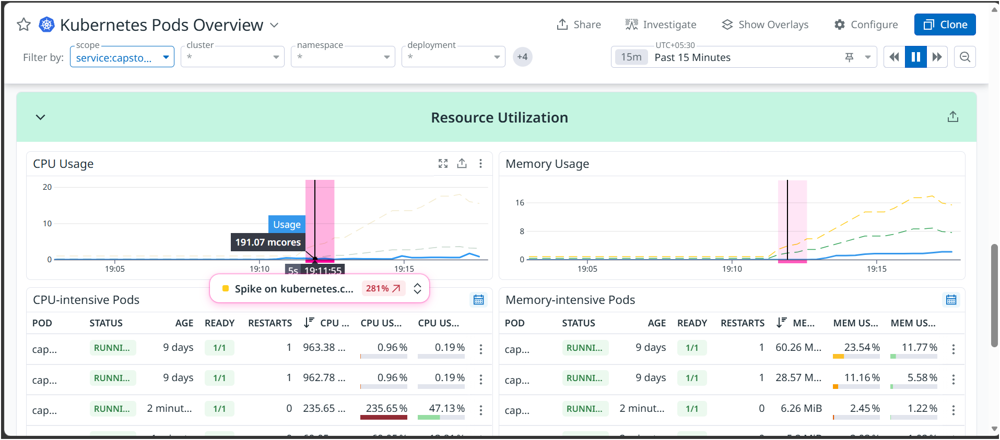
*Datadog live telemetry graph capturing real-time CPU utilization across active pods.*

---


## Repository Structure

```text
├── ansible/                  # Server configuration and runtime installation
├── frontend/                 # NGINX configuration and web assets
├── k8s/                      # Kubernetes manifests (Deployments, Services, HPA, Secrets)
├── screenshots/              # Production verification and pipeline evidence
├── src/                      # Java Spring Boot backend source code
├── terraform/                # Infrastructure as Code (AWS VPC, EC2, Security Groups)
├── Dockerfile                # Multi-stage container build configuration
├── Jenkinsfile               # Declarative CI/CD pipeline definition
├── pom.xml                   # Maven dependencies and build parameters
└── README.md                 # Project documentation
```

---

## Deployment & Verification Commands

### Infrastructure Provisioning
```bash
cd terraform
terraform init
terraform plan
terraform apply
```

### Host Configuration

```bash
cd ../ansible
ansible-playbook -i inventory.ini site.yml
```

### Cluster Deployment

```bash
kubectl apply -f k8s/
kubectl get pods -l app=capstone-app
kubectl get hpa
```

---


## Author

* **Shivam Gupta**
* Repository: [devops-capstone-project](https://github.com/shivamgupta898/devops-capstone-project)